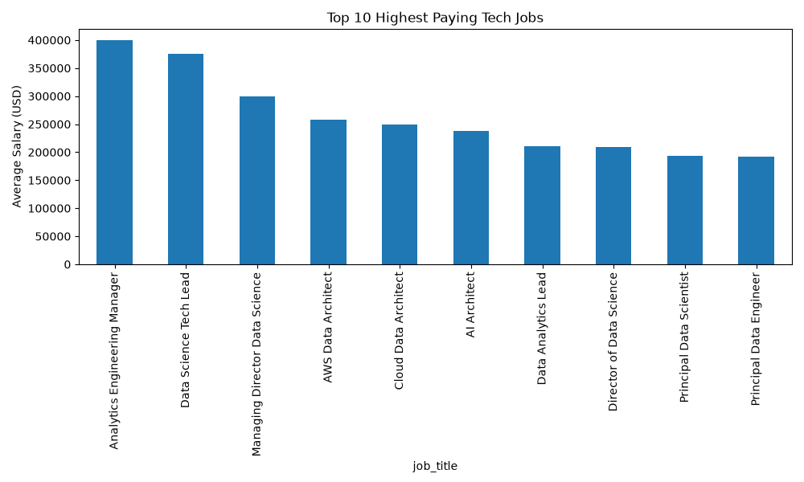
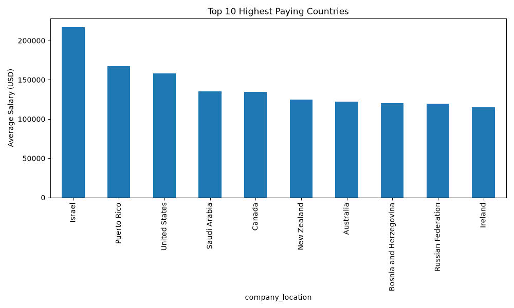
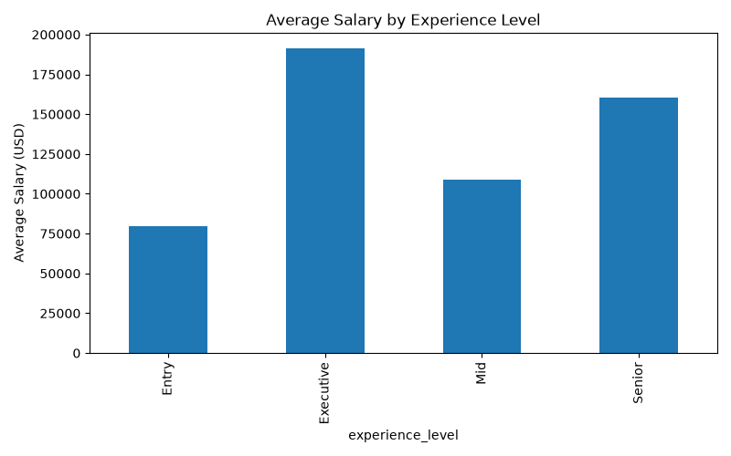
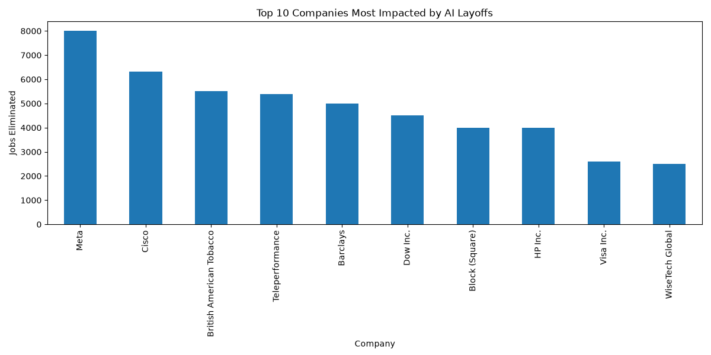
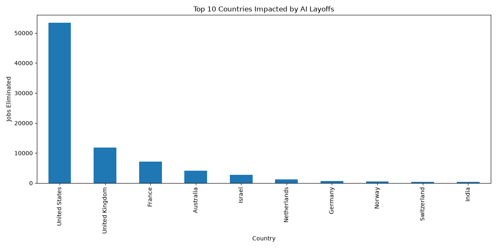
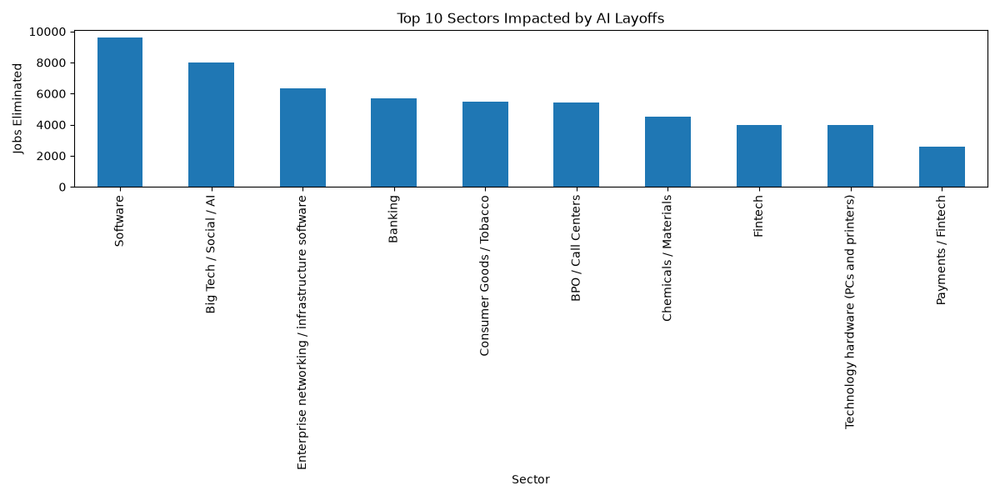

# Global Tech Salaries & AI Impact Analytics

## Project Overview

This project analyzes global technology salaries and the impact of AI-driven layoffs on the tech industry.

The objective is to answer key business questions:

- Which tech jobs are the highest paying?
- Which countries offer the highest salaries?
- How does experience impact salary?
- What is the impact of AI on technology employment?
- Which companies, countries, and sectors are most affected by AI-related layoffs?

The project follows a complete ETL (Extract, Transform, Load) pipeline and stores data in SQLite for further analysis.

---

## Datasets

### Tech Salaries Dataset

Contains information about:

- Job titles
- Experience levels
- Company locations
- Company sizes
- Salaries in USD

### AI Layoffs Dataset

Contains information about:

- Companies affected by AI adoption
- Countries
- Sectors
- Number of jobs eliminated
- Workforce impact percentages

## Data Sources

- Global Tech Salaries Dataset: [Kaggle Dataset Link]
- AI Layoffs Dataset: [Kaggle Dataset Link]

---

## Project Architecture

```text
global-tech-salaries-analytics/
│
├── data/
│   ├── raw/
│   └── processed/
│
├── database/
│   └── salaries.db
│
├── logs/
│
├── visualizations/
│   ├── ai_top_companies.png
│   ├── ai_top_countries.png
│   ├── ai_top_sectors.png
│   ├── experience_salary.png
│   ├── top_countries.png
│   └── top_jobs.png
│
├── src/
│   ├── ai_analysis.py
│   ├── analysis.py
│   ├── extract.py
│   ├── load.py
│   ├── logger_config.py
│   ├── pipeline.py
│   ├── transform.py
│   └── visualization.py
│
├── requirements.txt
├── README.md
└── .gitignore
```

---

## Technologies Used

- Python
- Pandas
- SQLite
- Matplotlib
- Git
- GitHub

---

## ETL Pipeline

### Extract

Load raw datasets from CSV files.

### Transform

- Remove duplicates
- Handle missing values
- Normalize column names
- Filter invalid salary values

### Analyze

Compute:

- Highest paying jobs
- Highest paying countries
- Salary by experience level
- Salary by company size
- AI layoffs analysis

### Visualize

Generate charts automatically:

- Top paying jobs
- Top paying countries
- Salary by experience
- AI layoffs by company
- AI layoffs by country
- AI layoffs by sector

### Load

Store cleaned data inside SQLite database.

---

## Key Findings

### Highest Paying Jobs

| Job Title | Average Salary |
|------------|--------------|
| Analytics Engineering Manager | $399,880 |
| Data Science Tech Lead | $375,000 |
| AI Architect | $237,484 |
| Principal Data Engineer | $192,500 |

### Highest Paying Countries

| Country | Average Salary |
|-----------|--------------|
| Israel | $217,332 |
| United States | $158,462 |
| Canada | $134,550 |

### Salary by Experience

| Experience Level | Average Salary |
|------------------|---------------|
| Executive | $191,512 |
| Senior | $160,278 |
| Mid | $108,715 |
| Entry | $79,921 |

### AI Impact

Average workforce affected:

**16.96%**

Most impacted companies:

- Meta
- Cisco
- Barclays
- Teleperformance
- British American Tobacco

Most impacted country:

- United States

Most impacted sector:

- Software

---

## Database Tables

### salaries

Stores cleaned salary records.

### ai_layoffs

Stores AI-related layoff events.

---

## Run The Project

Install dependencies:

```bash
pip install -r requirements.txt
```

Run the complete pipeline:

```bash
python src/pipeline.py
```

---
## Visualizations Preview

### Top Paying Tech Jobs



### Top Paying Countries



### Salary by Experience Level



### AI Layoffs by Company



### AI Layoffs by Country



### AI Layoffs by Sector


---

## Author

Alpha Diallo

Aspiring Data Engineer focused on:

- Data Engineering
- Data Analytics
- SQL
- Python
- Artificial Intelligence